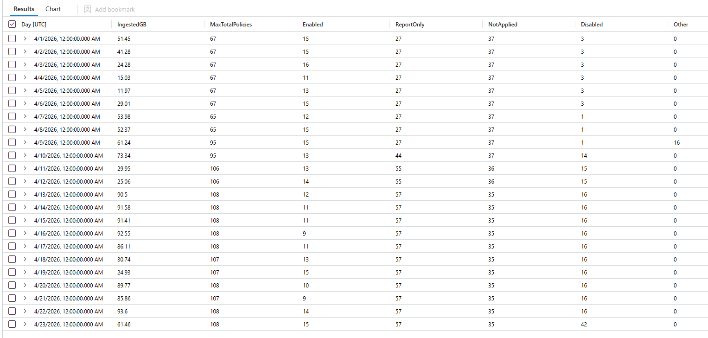

## TL;DR

- Every sign-in record in `AADNonInteractiveUserSignInLogs` carries **all** Conditional Access policies evaluated for it, including report-only, not-applied and **disabled** ones.
- More policies mean bigger records, and bigger records mean more ingestion. In the tenant below, adding about 40 report-only and disabled policies took the table from **~50 GB to ~90 GB per workday**.
- The query in this post lines up daily ingestion with the number and state of CA policies, so you can see the exact day a policy change hit your bill.
- **Check your Microsoft 365 E5 benefit first.** It covers up to 5 MB per licensed user per day across `AADNonInteractiveUserSignInLogs` and the other eligible Entra ID and Defender XDR tables. Bloat only costs money once you exceed that grant, but it always eats headroom other tables could use.
- **Fix the cause, not the column.** Consolidate your Conditional Access framework and clean up report-only and disabled policies first. If many disabled policies have to stay, strip just those entries at ingestion instead of dropping the column. Dropping `ConditionalAccessPolicies` entirely breaks detections, investigations and the very report-only analysis those policies exist for.

## The problem: Ingestion grows, sign-ins don't

`AADNonInteractiveUserSignInLogs` is one of the tables that quietly dominates the Sentinel bill in many tenants. Token refreshes, background app activity and service-to-service calls produce far more records than interactive sign-ins ever will.

Most people look at *how many* records arrive. What's less obvious is that **the size of each record depends on your Conditional Access configuration.** Add a batch of report-only policies to "test something" and ingestion goes up the next day, without a single extra user signing in.

That's exactly what happened in the tenant I'll use as the example in this post. Here's how to spot it, prove it and fix it.

## Background: What's inside `ConditionalAccessPolicies`

Every sign-in record has a `ConditionalAccessPolicies` column: an array with one entry per policy that Entra ID evaluated for that sign-in. Each entry contains the policy ID, display name, result, enforced grant and session controls, and more.

The key point is *which* policies end up in that array. It's not just the ones that applied:

| `result` value | What it means | In the record? |
|---|---|---|
| `success` / `failure` | Enforced policy, conditions matched | ✅ |
| `notApplied` | Enforced policy, conditions didn't match | ✅ |
| `reportOnlySuccess`, `reportOnlyFailure`, `reportOnlyInterrupted` | Report-only policy, conditions matched | ✅ |
| `reportOnlyNotApplied` | Report-only policy, conditions didn't match | ✅ |
| `notEnabled` | Disabled policy | ✅ |

A tenant with 60 Conditional Access policies therefore writes up to 60 policy objects into **every** sign-in record, for every token refresh of every user.

Report-only policies are the most common silent driver, because:

- They're evaluated against every sign-in that matches their base scope.
- They still produce an entry (`reportOnlyNotApplied`) when their conditions don't match.
- They don't block anything, so nobody connects them to an ingestion increase.
- A single new, broadly scoped report-only policy can add thousands of extra policy entries per day.

And the disabled policies you forgot to delete are still in there too, as `notEnabled`.

## Measuring it: The query

The query produces one row per day: the billable ingestion of `AADNonInteractiveUserSignInLogs` from the `Usage` table, next to the Conditional Access picture for that day.

```kql
let StartDate = startofday(ago(30d));
// Sample up to 500 sign-ins per day and reuse the same sample for both aggregations
let Sample = materialize(
    AADNonInteractiveUserSignInLogs
    | where TimeGenerated >= StartDate
    | extend Day = bin(TimeGenerated, 1d)
    | partition by Day (take 500)
    | extend CAPolicies = todynamic(tostring(ConditionalAccessPolicies)));
let Policies =
    Sample
    | summarize MaxTotalPolicies = max(array_length(CAPolicies)) by Day;
let PolicyStates =
    Sample
    | mv-expand CAPolicies
    | extend PolicyName   = tostring(CAPolicies.displayName),
             PolicyResult = tostring(CAPolicies.result)
    | extend State = case(
        PolicyResult in ("success", "failure"), "Enabled",
        PolicyResult startswith "reportOnly",  "ReportOnly",
        PolicyResult == "notApplied",          "NotApplied",
        PolicyResult == "notEnabled",          "Disabled",
                                               "Other")
    | summarize DistinctPolicies = dcount(PolicyName) by Day, State
    | evaluate pivot(State, sum(DistinctPolicies));
let Volume =
    Usage
    | where TimeGenerated >= StartDate
    | where DataType == "AADNonInteractiveUserSignInLogs"
    | summarize IngestedGB = sum(Quantity) / 1000.0 by Day = bin(TimeGenerated, 1d);
Volume
| join kind=leftouter Policies     on Day
| join kind=leftouter PolicyStates on Day
| project Day,
          IngestedGB = round(IngestedGB, 2),
          MaxTotalPolicies,
          Enabled    = column_ifexists("Enabled", long(null)),
          ReportOnly = column_ifexists("ReportOnly", long(null)),
          NotApplied = column_ifexists("NotApplied", long(null)),
          Disabled   = column_ifexists("Disabled", long(null)),
          Other      = column_ifexists("Other", long(null))
| order by Day asc
```

The query and its documentation also live on [GitHub](https://github.com/marvin-rse/defenderxdr/blob/main/AADNonInteractiveUserSignInLogs/ca-ingestion-analysis.md).

### What each column tells you

| Column | Meaning |
|---|---|
| `IngestedGB` | Billable ingestion for the table that day, in GB (`Usage.Quantity` is reported in MB, the query divides by 1,000) |
| `MaxTotalPolicies` | Highest number of CA policies attached to a single sign-in that day: the "record size ceiling" |
| `Enabled` | Distinct enforced policies that applied (`success` / `failure`) |
| `ReportOnly` | Distinct report-only policies seen, in any report-only state |
| `NotApplied` | Distinct enforced policies that didn't match |
| `Disabled` | Distinct disabled policies still showing up as `notEnabled` |
| `Other` | Any result value not covered above, as a forward-compatibility bucket |

### How it stays fast

Scanning a month of non-interactive sign-ins can take a while in a large tenant. The query avoids that with `partition by Day (take 500)`: it looks at no more than 500 records per day, however big the table is. `materialize()` makes sure both aggregations work on the *same* sample. The `Usage` table is pre-aggregated, so that part is cheap anyway.

Keep in mind this is a sample, not a census. A policy that exists but never shows up in the sampled records will be missing from the distinct counts. For more confidence, raise it to `take 2000`. For more speed, go down to `take 200`.

## Real-world example: Reading the output

Here's the output from a production tenant (anonymised) for April 2026:



Three phases stand out.

**Baseline (1–8 April).** `MaxTotalPolicies` sits at 65–67, with 27 report-only policies and 1–3 disabled ones. Regular workdays land around **50 GB**; the weekend and the Easter holidays (3–6 April) drop to 12–29 GB. That's a normal, healthy pattern: ingestion follows people.

**The change (9–10 April).** `MaxTotalPolicies` jumps from 65 to 95 within a day, `ReportOnly` goes from 27 to 44 and `Disabled` from 1 to 14. On 9 April the `Other` bucket briefly shows 16 policies in a state the query doesn't recognise. That alone is worth a look in the raw data, because it marks the day of the rollout.

**The new normal (from 13 April).** `MaxTotalPolicies` settles at 107–108, with 57 report-only and 16 disabled policies. Workdays now land at **86–94 GB**, weekends at 25–31 GB.

| | Before (1–8 Apr) | After (13–22 Apr) | Change |
|---|---|---|---|
| Ø ingestion per workday | ~50 GB | ~90 GB | **+81 %** |
| Ø ingestion per weekend day | ~13.5 GB | ~28 GB | **+106 %** |
| `MaxTotalPolicies` | 67 | 108 | +61 % |
| Report-only policies | 27 | 57 | +30 |
| Disabled policies | 1–3 | 16 | +13 |

That's roughly **40 GB of extra ingestion every workday**, while the sign-in pattern (workdays vs. weekends) stayed exactly the same. The increase in policies (+41) is almost entirely report-only (+30) and disabled (+13) policies: policies that don't enforce anything.

The numbers don't scale 1:1. `MaxTotalPolicies` is the ceiling, not the average per record, and each policy object also carries its grant and session controls. The direction and timing, however, are unmistakable.

On 23 April, `Disabled` jumps again to 42. That's a good example of why you should keep running this query: the next change is already on its way. (The lower GB value that day is because the query ran during the day, so the day is incomplete.)

### Patterns to look for

| Pattern | Likely cause |
|---|---|
| `IngestedGB` grows, policy counts stay flat | More sign-in events: a new app, a service principal, a retry loop |
| `IngestedGB` grows together with `ReportOnly` | New report-only policy added, or an existing one scoped broader |
| `IngestedGB` grows together with `Enabled` | New enforced policy added |
| `MaxTotalPolicies` jumps | Every record got bigger, so check what was created that day |
| `Disabled` grows | Policies switched off but not deleted, and they still end up in every record |
| `Other` has values | New or unexpected result values, so check the raw data |

## What it really costs: The Microsoft 365 E5 benefit

Before you calculate savings, check whether you're paying for this table at all. With Microsoft 365 E5 (and E7, A5, F5, G5 or the matching Security add-ons), Microsoft covers up to **5 MB of eligible data per licensed user per day** in Microsoft Sentinel. The grant is applied to your bill automatically, no sign-up needed. ([Microsoft Sentinel benefit for Microsoft 365 customers](https://azure.microsoft.com/pricing/offers/sentinel-microsoft-365-offer))

`AADNonInteractiveUserSignInLogs` is one of the eligible tables, together with `SigninLogs`, `AuditLogs`, the other Entra ID sign-in tables and the Defender XDR advanced hunting tables such as `DeviceProcessEvents` or `EmailEvents`.

That changes how to read the numbers above:

- **Below the grant, bigger records cost you nothing extra.** A tenant with 10,000 E5 users has a grant of about 50 GB per day.
- **The grant is shared across all eligible tables.** Every gigabyte that inflated sign-in records take up is a gigabyte no longer available for Defender XDR data. Policy bloat pushes *other* tables over the line.
- **Above the grant, every additional GB is billed** at the normal analytics tier price.

This query shows how much of your grant the eligible tables use each day. Set `E5Users` to your number of eligible licenses:

```kql
let E5Users = 10000;                            // number of eligible licenses
let DailyGrantGB = E5Users * 5 / 1000.0;        // 5 MB per user per day
let EligibleTables = dynamic([
    "SigninLogs", "AADNonInteractiveUserSignInLogs", "AADServicePrincipalSignInLogs",
    "AADManagedIdentitySignInLogs", "AADProvisioningLogs", "ADFSSignInLogs", "AuditLogs",
    "McasShadowItReporting", "InformationProtectionLogs_CL",
    "DeviceEvents", "DeviceFileEvents", "DeviceImageLoadEvents", "DeviceInfo",
    "DeviceLogonEvents", "DeviceNetworkEvents", "DeviceNetworkInfo", "DeviceProcessEvents",
    "DeviceRegistryEvents", "DeviceFileCertificateInfo", "DynamicEventCollection",
    "CloudAppEvents", "EmailAttachmentInfo", "EmailEvents", "EmailPostDeliveryEvents",
    "EmailUrlInfo", "IdentityLogonEvents", "IdentityQueryEvents", "IdentityDirectoryEvents",
    "AlertEvidence"]);
Usage
| where TimeGenerated >= startofday(ago(30d))
| where IsBillable == true
| where DataType in (EligibleTables)
| summarize EligibleGB = round(sum(Quantity) / 1000.0, 2),
            NonInteractiveGB = round(sumif(Quantity, DataType == "AADNonInteractiveUserSignInLogs") / 1000.0, 2)
    by Day = bin(TimeGenerated, 1d)
| extend GrantGB = DailyGrantGB,
         OverGrantGB = round(max_of(EligibleGB - DailyGrantGB, 0.0), 2),
         GrantUsedPercent = round(100.0 * EligibleGB / DailyGrantGB, 1)
| order by Day asc
```

If `OverGrantGB` is `0` on every day, Conditional Access bloat isn't costing you money yet, but it's eating headroom you'll want once you onboard more data. If it's above `0`, the growth you found with the first query lands directly on your bill.

You can also check the bill itself: in Azure Cost Management, group the cost analysis by meter and look for the Microsoft 365 meters. Covered ingestion shows up there at zero cost.

## Finding the policy behind the spike

Once you know the day, this query lists report-only policies by the first day they appeared in the sample, together with how often they were evaluated:

```kql
let SpikeWindowStart = startofday(ago(30d)); // set this to a few days before the spike
AADNonInteractiveUserSignInLogs
| where TimeGenerated >= SpikeWindowStart
| extend Day = bin(TimeGenerated, 1d)
| partition by Day (take 500)
| extend CAPolicies = todynamic(tostring(ConditionalAccessPolicies))
| mv-expand CAPolicies
| extend PolicyName   = tostring(CAPolicies.displayName),
         PolicyResult = tostring(CAPolicies.result)
| where PolicyResult startswith "reportOnly"
| summarize FirstSeen = min(Day), Evaluations = count() by PolicyName
| order by FirstSeen desc, Evaluations desc
```

The policies at the top with a `FirstSeen` on your spike day are your prime suspects. To find disabled policies instead, replace the `where` line with `| where PolicyResult == "notEnabled"`. Then cross-check in the Entra audit log who created or changed them, and why.

## Fixing it

### Option 1: Fix the cause with policy hygiene (recommended)

This is the lever that saves money **without** losing any security value:

- **Treat report-only as temporary.** Report-only mode exists to test a policy before enforcing it. Give every report-only policy an owner and an end date, then enable it or delete it. 57 report-only policies is not a test anymore, it's a backlog.
- **Delete disabled policies.** A disabled policy does nothing except end up in every record as `notEnabled`. If you want to keep it for reference, export its JSON (or keep it in your Conditional Access as code repository) and delete it from the tenant.
- **Scope test policies narrowly.** Test with a pilot group instead of "All users". A report-only policy scoped to 50 users only shows up for those 50 users.
- **Consolidate.** Ten policies that each do one small thing can often be merged into a few. That keeps records smaller and the configuration easier to reason about. Microsoft allows a fixed maximum of 240 Conditional Access policies per tenant, counted across all states: on, report-only and off. ([Microsoft Learn](https://learn.microsoft.com/entra/identity/conditional-access/plan-conditional-access)) That's a limit, not a target.

In the example tenant, cleaning up the 30 new report-only and 13 disabled policies would take `MaxTotalPolicies` back from 108 to about 65, and ingestion with it.

### Option 2: Drop the column? Think twice

The obvious "quick fix" is an ingestion-time transformation that removes `ConditionalAccessPolicies` from `AADNonInteractiveUserSignInLogs` before it's stored. It works, and it cuts the record size dramatically. **For most environments I wouldn't do it**, because that column is what turns a sign-in log into a security log:

- **Detections lose their context.** Analytics rules and hunting queries that look for sign-ins where MFA or a compliant device was *not* required, or where a specific policy failed, rely on the policy details. `ConditionalAccessStatus` alone only tells you "success", "failure" or "notApplied". It doesn't tell you *which* policy, or which controls were enforced.
- **Investigations get blind.** During a token theft or AiTM investigation, the first question is usually "why was this session allowed from that IP or device?" The answer is in the policy results. Without them, you're back to clicking through the Entra portal sign-in by sign-in, which only works within Entra's own retention.
- **Gap analysis disappears.** `notApplied` entries are exactly what shows you policy exclusions being used, such as the break-glass account, the excluded service account or the "temporary" exclusion from two years ago. Attackers love exclusions. You want that data.
- **Report-only becomes pointless.** Report-only policies exist so you can evaluate their impact before enforcing them. That evaluation, for example in the Conditional Access insights and reporting workbook, is built on exactly this column. Drop it, and your report-only policies cost nothing but also tell you nothing.
- **You can't get it back.** Once data is dropped at ingestion, it's gone. Retention and compliance requirements don't care that the column was expensive.

### Option 3: Remove disabled policies from the records (only if you have many)

Disabled policies are the one part of the array that carries no information about the sign-in at all. Each one is written into every record as `notEnabled`, whether it's relevant or not.

The obvious fix is to delete them (Option 1). But sometimes that's not an option: policies kept for a quick rollback, policies managed by a pipeline or a service provider, or a change process that takes weeks. If that leaves you with **a lot** of disabled policies, a workspace transformation can strip just those entries from `ConditionalAccessPolicies` at ingestion.

If you only have a handful of disabled policies, skip this option. The savings are small, and deleting the policies does the same job with zero risk.

#### What to keep

Everything except `notEnabled`, including **all report-only results**:

| Result | Keep? | Why |
|---|---|---|
| `success`, `failure` | ✅ | The actual decision |
| `notApplied` | ✅ | Exclusion and gap analysis (see Option 2) |
| `reportOnlySuccess`, `reportOnlyFailure`, `reportOnlyInterrupted` | ✅ | What a report-only policy *would* have done |
| `reportOnlyNotApplied` | ✅ | Needed to evaluate report-only policies before you enable them |
| `notEnabled` | ❌ | A disabled policy says nothing about the sign-in |

#### The transformation

Transformations process one record at a time and only support a subset of KQL. `mv-expand`, `mv-apply` and `summarize` aren't available, so you can't loop over the array. ([Microsoft Learn](https://learn.microsoft.com/azure/azure-monitor/data-collection/data-collection-transformations-kql)) What *is* available is `replace()` with a regular expression, and in this table `ConditionalAccessPolicies` is stored as a JSON string. So the transformation cuts the disabled entries out of the string:

```kql
source
| extend ConditionalAccessPolicies = replace(@'\{(?:[^{}]|\{(?:[^{}]|\{[^{}]*\})*\})*?"result"\s*:\s*"notEnabled"(?:[^{}]|\{(?:[^{}]|\{[^{}]*\})*\})*\}\s*,?\s*', '', ConditionalAccessPolicies)
| extend ConditionalAccessPolicies = replace(@',\s*\]', ']', ConditionalAccessPolicies)
```

The first line removes every policy object whose `result` is `notEnabled`, including nested fields like `includeRulesSatisfied`. The second line removes a trailing comma before `]`, so the result stays valid JSON.

In a tenant with 19 policies, one of them disabled, a sign-in record went from 19 to 18 entries. Every other result, including the report-only policy, stayed untouched. In the example tenant from above, with 16 disabled policies in every record, the effect is much bigger.

`AADNonInteractiveUserSignInLogs` supports workspace transformations, and if Microsoft Sentinel is enabled on the workspace, filtering analytics tables doesn't create an extra processing charge. ([Microsoft Learn](https://learn.microsoft.com/azure/azure-monitor/essentials/data-collection-transformations-workspace))

Before you deploy it, check the result against your real data. This regular Log Analytics query (where the function is called `replace_regex`) compares the trimmed array with the expected result and shows the savings:

```kql
AADNonInteractiveUserSignInLogs
| where TimeGenerated > ago(1h)
| take 1000
| extend Trimmed = replace_regex(ConditionalAccessPolicies, @'\{(?:[^{}]|\{(?:[^{}]|\{[^{}]*\})*\})*?"result"\s*:\s*"notEnabled"(?:[^{}]|\{(?:[^{}]|\{[^{}]*\})*\})*\}\s*,?\s*', '')
| extend Trimmed = replace_regex(Trimmed, @',\s*\]', ']')
| extend After = array_length(todynamic(Trimmed))
| mv-apply p = todynamic(ConditionalAccessPolicies) on (
    summarize Expected = countif(tostring(p.result) != "notEnabled")
  )
| summarize Records      = count(),
            Mismatches   = countif(After != Expected),
            InvalidJson  = countif(isnull(After)),
            SavedPercent = round(100.0 - 100.0 * sum(strlen(Trimmed)) / sum(strlen(ConditionalAccessPolicies)), 1)
```

`Mismatches` and `InvalidJson` should both be `0`.


A regular expression on JSON is less robust than real parsing. It assumes that policy names don't contain curly braces, which is practically always the case, but worth knowing. Test it in a lab workspace first, check that no analytics rule or workbook relies on `notEnabled` entries, and document the decision.


My take: fix the framework first. Consolidate, delete what's disabled and turn report-only policies into a decision. Use the transformation only if a large number of disabled policies has to stay for a reason you can't change.

## Key takeaways

- Conditional Access changes don't only change who can sign in. They change how much **every** sign-in costs you to store.
- Report-only and disabled policies are the usual suspects: they enforce nothing, but they're in every record.
- Measure first: the query in this post shows you the exact day and the policy state behind an ingestion change.
- Know your E5 grant. Inflated sign-in records use up the free allowance that your Defender XDR data would otherwise get.
- Consolidate your Conditional Access framework before you touch the data. The policy limit is a ceiling, not a target. The `ConditionalAccessPolicies` column is too valuable for detections and investigations to drop for convenience.
- If you do touch the data, remove only what carries no information, which means disabled policies. Keep report-only results, they're how you evaluate a policy before enabling it.

*Seeing different patterns in your tenant? Let me know on [LinkedIn](https://www.linkedin.com/in/marvin-rse/).*
