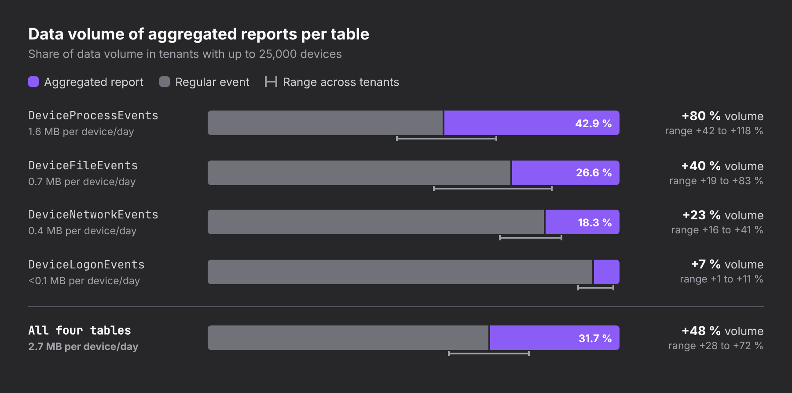
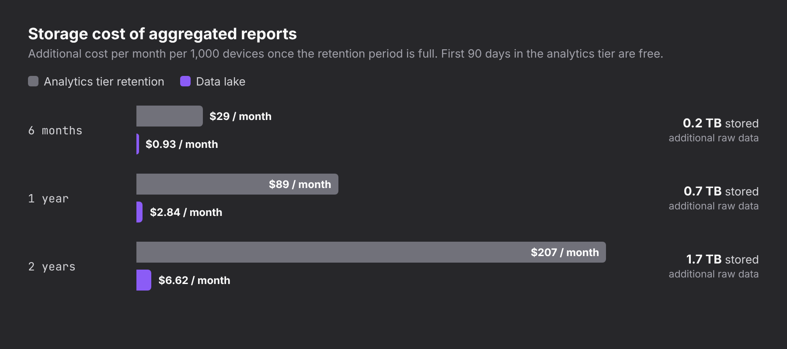

## TL;DR

- **Aggregated reporting** adds hourly summaries of activity that Defender for Endpoint previously didn't report at all: repeated process launches, file changes, network connections and logons.
- **In most environments, it's free.** It's part of Defender for Endpoint Plan 2, and the data lives in Defender XDR advanced hunting at no extra cost. With ISOC, the Device tables also come with 90 days of retention included.
- **It costs money when** you stream the Device tables into the Microsoft Sentinel analytics tier and you're already above your E5 grant, or when you keep the data longer than the included retention.
- In those cases, plan for about **50 % more billed size** in the four Device tables (28 to 72 % in the environments I measured). `DeviceProcessEvents` grows by 80 % on average. Aggregated rows are small, so counting rows overstates the cost by a factor of two to three.
- **My recommendation: turn it on.** Give it a few weeks, then validate the extra volume with the query below and decide per table where the data should live.

## What aggregated reporting does

By default, Defender for Endpoint doesn't send every single event from a device. Low-value, high-frequency activity, like the same process starting hundreds of times or a service retrying the same connection, is partly left out to keep the volume down.

Aggregated reporting changes that. Instead of sending each of those events, the sensor summarises them over **one hour** and sends one row per unique activity, with a counter of how often it happened ([Microsoft Learn](https://learn.microsoft.com/defender-endpoint/aggregated-reporting)).

These summaries show up as their own ActionTypes in the existing tables:

| Table | Aggregated ActionTypes |
|---|---|
| `DeviceProcessEvents` | `ProcessCreatedAggregatedReport` |
| `DeviceFileEvents` | `FileCreatedAggregatedReport`, `FileModifiedAggregatedReport`, `FileRenamedAggregatedReport` |
| `DeviceNetworkEvents` | `ConnectionSuccessAggregatedReport`, `ConnectionFailedAggregatedReport` |
| `DeviceLogonEvents` | `LogonSuccessAggregatedReport`, `LogonFailedAggregatedReport` |

The number of underlying events is stored in `AdditionalFields.uniqueEventsAggregated`.

To turn it on, go to **Settings → Endpoints → Advanced features → Aggregated reporting**. It requires Defender for Endpoint Plan 2 and a supported Windows version, and according to Microsoft it "can take up to seven days for aggregated reports to become available" ([Microsoft Learn](https://learn.microsoft.com/defender-endpoint/aggregated-reporting)).

## Why you want it

Detections fire on single, suspicious events. Investigations are different. Once something has happened, the first questions are about everything *around* it: What else ran on this device? Where did it connect to? Did the same thing happen yesterday?

That's exactly the kind of activity aggregated reporting adds: the repetitive, "boring" behaviour that was previously sampled away.

- **Scoping.** A process that ran 400 times in an hour on one device, and nowhere else, stands out immediately.
- **Lateral movement and brute force.** Repeated failed logons and connection attempts become visible as one row with a count, instead of a gap in the timeline.
- **Living off the land.** Tools that blend in by doing normal things often, like `powershell.exe`, `rundll32.exe` or remote management tools, are exactly what gets summarised.


In an incident response, nobody has ever complained about having too many logs from a device. What hurts is the gap in the timeline where the data you need was never collected.


## What it costs: The extra data

Microsoft is open about the downside: turning on aggregated reporting "might incur higher storage costs" if you stream the Defender for Endpoint tables to a SIEM ([Microsoft Learn](https://learn.microsoft.com/defender-endpoint/aggregated-reporting)). There's no number attached. So I measured it across several production environments with up to 25,000 devices, over seven days each, and checked the results against the billed size in Microsoft Sentinel.



| Table | Additional rows | Additional data volume | Range (volume) |
|---|---|---|---|
| `DeviceProcessEvents` | +168 % | **+80 %** | +42 to +118 % |
| `DeviceFileEvents` | +120 % | **+40 %** | +19 to +83 % |
| `DeviceNetworkEvents` | +73 % | **+23 %** | +16 to +41 % |
| `DeviceLogonEvents` | +15 % | **+7 %** | +1 to +11 % |
| **All four tables** | | **+48 %** | +28 to +72 % |

Three things stand out:

1. **Aggregated reporting adds data, it doesn't replace any.** `ProcessCreated` and `FileCreated` are still there. The aggregated rows come on top.
2. **Processes and files carry the cost.** `DeviceProcessEvents` grew by 80 % on average and more than doubled in two environments. These are also among the largest Device tables in most environments.
3. **Rows aren't bytes.** An aggregated row is only 30 to 60 % the size of a regular event in the same table. In `DeviceFileEvents`, aggregated reports more than doubled the row count, but added less than half in billed size. Estimating the cost from row counts alone overstates it by a factor of two to three.

Per device and day, aggregated reports added about **2.7 MB** across the four tables on average, from 1.6 MB in one environment to 5.0 MB in another.

### Why the numbers vary so much

The size of a row is almost the same everywhere. A regular process event is about 1,800 to 2,000 bytes, an aggregated report about half of that. What differs is **how many aggregated reports a device produces**:

| `DeviceProcessEvents` per device and day | Lowest environment | Highest environment |
|---|---|---|
| Regular events | ~900 | ~1,600 |
| Aggregated reports | ~1,100 | ~4,300 |

Regular process events are in a narrow range everywhere. Aggregated reports vary by a factor of four. That's expected: they capture exactly the repetitive process launches that weren't reported before, like scripts, monitoring and management agents, scheduled tasks or software that keeps starting helper processes. How much of that runs on your devices depends on your environment, not on its size.

The result: In one environment, aggregated reports added 42 % to `DeviceProcessEvents`. In another, they more than doubled it with +118 %. The averages in this post are a good first estimate, but only a measurement in your own environment tells you where you are.

## Does it cost you money?

That depends on where the data goes.

- **Defender XDR only:** The data stays in Defender XDR advanced hunting for 30 days. No extra cost.
- **Streamed to Microsoft Sentinel:** Every additional row is ingested and billed, unless it's covered by your Microsoft 365 E5 benefit. The Device tables are eligible for the grant of 5 MB per licensed user per day, but so are Entra ID sign-in logs and other Defender tables, and they all share the same grant. I've written about the E5 benefit in my [previous post](/posts/conditional-access-noninteractive-signin-costs/#what-it-really-costs-the-microsoft-365-e5-benefit).

- **Streamed to the Sentinel data lake only:** If you keep the Device tables in the data lake tier and use Defender XDR advanced hunting for the first 30 days, the analytics tier isn't involved at all. You pay data lake ingestion and data processing per GB, plus storage.

At about 2.7 MB per device and day, aggregated reporting alone uses up **more than half of the E5 grant** for one user, before any sign-in logs or other Defender data. In one environment, it was 5 MB, the entire grant. Where that grant is already used up, the tier makes a huge difference. For 1,000 devices, that's about 2.7 GB per day or 82 GB per month:

| Ingested into | Price per GB | Additional cost per month |
|---|---|---|
| **Analytics tier** (pay-as-you-go) | $5.16 | **about $420** |
| **Data lake tier** (ingestion + data processing) | $0.06 + $0.12 | **about $15** |

Prices are pay-as-you-go list prices for North Europe in USD. Check the [pricing page](https://azure.microsoft.com/pricing/details/microsoft-sentinel/) for your region and agreement.

## Retention multiplies it

Ingestion is only the first bill. Most environments keep Device data much longer than a few weeks, for compliance, for threat hunting, or because an incident is often discovered months after it started. Every extra gigabyte per day from aggregated reporting is then stored for the whole retention period.

Microsoft Sentinel bills that in several places ([Microsoft Learn](https://learn.microsoft.com/azure/sentinel/billing)):

| Where the data lives | What you pay for |
|---|---|
| **Analytics tier, first 90 days** | Ingestion only. Retention is free for 90 days. |
| **Analytics tier, beyond 90 days** | Log Analytics retention, per GB and month. |
| **Data lake tier, after analytics retention ends** | Data lake storage, per GB and month, billed at a fixed compression rate of 6:1. 600 GB of raw data are billed as 100 GB. |
| **Querying the data lake** | Per GB of *uncompressed* data scanned by KQL queries and KQL jobs. |
| **Data lake only (table stored in the data lake tier)** | Data lake ingestion and data processing, per GB. |

The E5 benefit doesn't help here. It covers "up to 5 MB of data ingestion per user per day", not storage ([Microsoft Sentinel benefit for Microsoft 365 customers](https://azure.microsoft.com/pricing/offers/sentinel-microsoft-365-offer)).



A quick example: 1,000 devices × 2.7 GB of aggregated reports per day. With one year of retention, that's around **1 TB of additional raw data** at any point in time. The first 90 days in the analytics tier are free. Where the rest goes makes all the difference:

- **Data lake:** The remaining ~740 GB are billed as about 125 GB of compressed storage. At $0.023 per GB and month, that's **about $3 per month**, plus every query that has to scan it.
- **Analytics tier:** The same ~740 GB as analytics retention at $0.12 per GB and month cost **about $89 per month**.

Prices are pay-as-you-go list prices for North Europe in USD.

Two things follow from that:

- **The analytics tier is the expensive part.** In the data lake, both ingestion and storage are cheap. The biggest lever is whether the extra rows go into the analytics tier at all.
- **Long retention makes queries expensive, too.** Hunting over a year of aggregated Device data in the data lake scans the uncompressed volume. Narrow time ranges and filters on `ActionType` keep that in check.

## What ISOC changes

Microsoft's new **Integrated Security Operations Center (ISOC)** in Defender changes this calculation. Eligible Defender tables, including all four Device tables from this post, are no longer duplicated into a Sentinel workspace, and ISOC includes **90 days of retention** for them at no additional cost ([Microsoft Learn](https://learn.microsoft.com/defender-xdr/integrated-security-operations-data-billing-retention)). In that model, aggregated reporting doesn't add ingestion cost for these tables. Only retention beyond 90 days is billed.

Many environments can't make that move yet. The transition is permanent and converts every Sentinel workspace in the tenant, negotiated Sentinel discounts and commitment tiers don't carry over, and the E5 ingestion benefit doesn't apply to ISOC usage ([Microsoft Learn](https://learn.microsoft.com/azure/sentinel/transition-existing-sentinel-deployment)).

Even so, it's worth a look right now: In the Defender portal, **SOC optimization** shows **Lower Defender data costs** recommendations with a monthly estimated data volume per Defender table ([Microsoft Learn](https://learn.microsoft.com/azure/sentinel/transition-soc-optimization-recommendations)). That's a good place to sanity-check what your Device tables, including the aggregated reports, actually cost you today. More on ISOC in a separate post soon.

## Measure it in your environment

Run this in Defender XDR advanced hunting. It shows, per table, how many rows and how much data the aggregated reports add:

```kql
let Days = 7;                               // full days, ending today 00:00
let Start = startofday(ago(Days * 1d));
let End = startofday(now());
let SamplePerMille = 200;                   // share of devices used to measure row size, see notes
let Data = union withsource=Table DeviceFileEvents, DeviceProcessEvents, DeviceNetworkEvents, DeviceLogonEvents
    | where Timestamp between (Start .. End)
    | extend Aggregated = ActionType endswith "AggregatedReport";
let Counts = Data
    | summarize Rows = count(), Devices = dcount(DeviceId) by Table, Aggregated;
let Sizes = Data
    | where hash(DeviceId, 1000) < SamplePerMille
    | extend Bag = bag_remove_keys(pack_all(true), dynamic(["Table", "Aggregated"]))
    | extend RowBytes = strlen(tostring(Bag)) - strlen(tostring(bag_keys(Bag)))
    | summarize BytesPerRow = avg(RowBytes), SampleRows = count() by Table, Aggregated;
Counts
| join kind=inner Sizes on Table, Aggregated
| extend Bytes = Rows * BytesPerRow
| summarize Devices = max(Devices),
            AggRows = sumif(Rows, Aggregated), RegularRows = sumif(Rows, not(Aggregated)),
            AggBytesPerRow = round(maxif(BytesPerRow, Aggregated)), RegularBytesPerRow = round(maxif(BytesPerRow, not(Aggregated))),
            AggBytes = sumif(Bytes, Aggregated), RegularBytes = sumif(Bytes, not(Aggregated)),
            SampleRows = sum(SampleRows) by Table
| extend IncreaseRows = round(100.0 * AggRows / RegularRows, 1),
         IncreaseSize = round(100.0 * AggBytes / RegularBytes, 1),
         AggMBPerDeviceDay = round(AggBytes / 1e6 / Devices / Days, 2)
| project Table, Devices, AggRows, RegularRows, AggBytesPerRow, RegularBytesPerRow,
          IncreaseRows, IncreaseSize, AggMBPerDeviceDay, SampleRows
| order by Table asc
```

A few notes:

- Advanced hunting has no billed size. The query approximates it from the string length of all non-empty values, which is how Log Analytics calculates the billed size of a record ([Microsoft Learn](https://learn.microsoft.com/azure/azure-monitor/logs/cost-logs)). Compared with `_BilledSize` in Sentinel, `IncreaseSize` was within two percentage points. The absolute values in bytes and MB come out about 10 % high.
- Measuring the size of every row is expensive. The query counts all rows, but measures the row size only on a sample of devices, then multiplies the two. Row sizes are very stable, so a sample of a few thousand devices is enough: `SamplePerMille = 200` (20 %) for up to 10,000 devices, `20` (2 %) for very large tenants.
- If the query still hits resource limits, start with `Days = 1` and increase it step by step. A full week is worth it, though: `DeviceFileEvents` in particular varies a lot from week to week.
- Don't use `strlen(tostring(pack_all()))` for this. With a `union`, it includes every empty column of all four tables, and aggregated rows look almost as large as regular events.

If the Device tables are already streamed to Sentinel, you can measure the billed size directly:

```kql
union withsource=Table DeviceFileEvents, DeviceProcessEvents, DeviceNetworkEvents, DeviceLogonEvents
| where TimeGenerated > ago(7d)
| extend Aggregated = ActionType endswith "AggregatedReport"
| summarize AggGB = sumif(_BilledSize, Aggregated) / 1e9,
            RegularGB = sumif(_BilledSize, not(Aggregated)) / 1e9,
            AggRows = countif(Aggregated), RegularRows = countif(not(Aggregated)) by Table
| extend IncreaseSize = round(100 * AggGB / RegularGB, 1),
         IncreaseRows = round(100.0 * AggRows / RegularRows, 1)
| order by Table asc
```

## Your options

1. **Turn it on and stay in Defender XDR.** If the Device tables aren't streamed to the Sentinel analytics tier or data lake and the 30 days in advanced hunting are enough for you, there's no additional cost at all. This is the easy choice.
2. **Turn it on and keep everything in Sentinel.** This works well if you're within your E5 grant and keep a short retention. Honestly, I doubt the grant will be enough in most environments. Aggregated reporting alone takes more than half of it, and the sign-in logs compete for the same 5 MB, as I showed in my [post on Conditional Access and non-interactive sign-ins](/posts/conditional-access-noninteractive-signin-costs/).
3. **Turn it on, but keep the Device tables out of the analytics tier.** Microsoft Sentinel can't split the Defender XDR tables, so you can't send only the aggregated rows to a cheaper tier. What you can do is mirror a whole Device table into the data lake only, without the analytics tier. That's much cheaper, and Defender XDR advanced hunting still covers the most recent 30 days.
4. **Turn it on and move to ISOC, once you can.** The Device tables then come with 90 days of retention included, and the extra rows don't add ingestion cost.
5. **Leave it off.** You save the data, and you keep the gap in your timeline.

## Check your detections

Aggregated reports use new ActionTypes. Existing analytics rules and hunting queries keep working, but they don't see the new rows:

- A query on `ActionType == "ProcessCreated"` ignores `ProcessCreatedAggregatedReport`.
- A query that counts events with `count()` undercounts, because one aggregated row can stand for hundreds of events. Use `uniqueEventsAggregated` instead.
- New detections can use the counter directly, for example more than 10 failed logons from one source within an hour.

```kql
DeviceLogonEvents
| where Timestamp > ago(1d)
| where ActionType == "LogonFailedAggregatedReport"
| extend Attempts = toint(todynamic(AdditionalFields).uniqueEventsAggregated)
| where Attempts > 10
| project Timestamp, DeviceName, AccountName, RemoteIP, Attempts
| order by Attempts desc
```

## Key takeaways

- Aggregated reporting fills real gaps in the device timeline, exactly where investigations need context.
- It adds rows, it doesn't replace them. The four Device tables grew by about 50 % in billed size (28 to 72 %), process events by 80 % on average.
- Measure in bytes, not rows. Aggregated rows are much smaller than regular events.
- In Defender XDR alone, that's free. In Sentinel, it competes for the same E5 grant as your sign-in logs. In the data lake, storing it is cheap.
- Turn it on, measure with the query above, and decide per table where the extra rows live and how long you keep them.

*Running aggregated reporting already? I'd love to hear what it does to your numbers on [LinkedIn](https://www.linkedin.com/in/marvin-rse/).*
